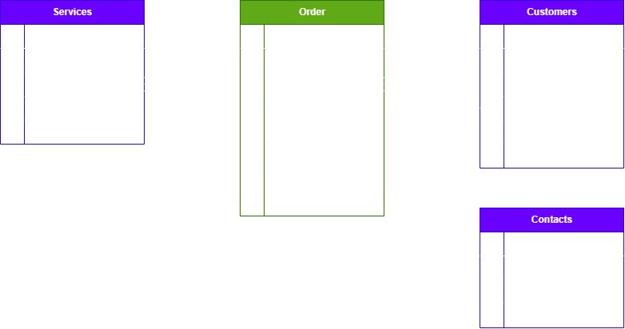

<h1>ViruVarvidVeebileht</h1>

Project: https://github.com/users/Apeirophobia/projects/3

<h2>Developers</h2>
Ervin Püsijainen
Savva Smirnyagin
Artur Petrovski

<h2>Project Setup</h2>

Clone project to your system

Open the project in Visual Studio Code

Open Terminal in Visual Studio Code

Make sure that you are in the root directory: "...\ViruVarvidVeebileht"

<h3> Backend setup </h3>
in Command Prompt run: "cd backend"
If you have "package-lock.json" then simply type "npm install"

else:
Install following packages: npm install 'package_name'
If (DEV) then: npm install 'package_name' -D
<ul>
    <li>express</li>
    <li>dotenv</li>
    <li>sequelize</li>
    <li>mariadb</li>
    <li>ors</li>
    <li>cors</li>
    <li>uuid</li>
    <li>bcrypt</li>
    <!-- Dev Dependencies -->
    <li>ejs(DEV)</li>
    <li>nodemon (DEV)</li>
    <li>typescript (DEV)</li>
    <li>ts-node (DEV)</li>
</ul>

Create file named: ".env" - use ".env.example" as a base
.env contains secrets that are needed to run the APIs and connect to the database.

In backend directory: "...\ViruVaravadVeebileht\backend"
run: npm run dev

to close server: CTRL + C in Terminal

<h3>Testing CRUD</h3>
in .../routes/appRoutes.js there is every route needed to test the CRUD functionality
to test these routes, we recommend using Postman or Insomnia softwares,
Notice! Create and Modify methods (put, post requests) require request body (type of Form URL Encoded) to function
Incase parameters are missing, server will return an error.

<h3>Production construction</h3>

In backend directory: "...\ViruVaravadVeebileht\backend"
Construct production code: npm run build
to run production code: npm run start
to close server: CTRL + C in Terminal

<h2>Project Database Entity Relationship Diagram</h2>

